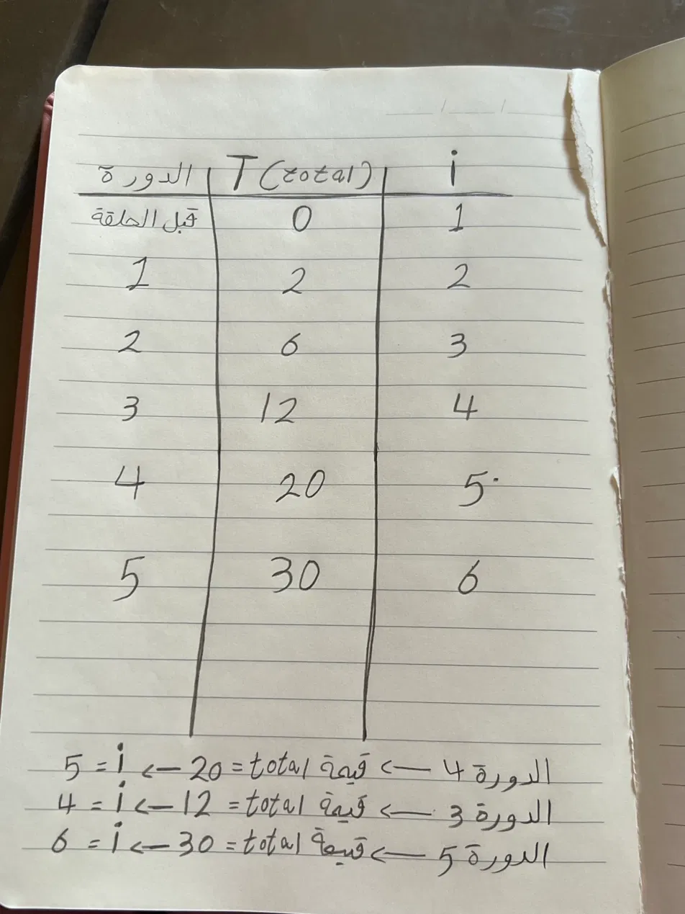

# 1. الفرق بين for و while

الأمثلة هنا من عندي، وكلها عن الطلبات والشحنات.

- for: أستخدمها إذا كنت أعرف عدد الشحنات.
- while: أستخدمها إذا كان التكرار يعتمد على حالة الشحنة.

مثال for من الشغل: مراجعة جميع طلبات الشحنات لليوم الواحد تلو الآخر

مثال while من الشغل: متابعة حالة الشحنة حتى يتم تسليمها للعميل

## 2. تتبع الكود: print و return

```python
def add(a, b):
    print(a + b)

def multiply(a, b):
    return a * b

x = add(2, 3)
y = multiply(2, 3)
print(x, y)

for i in range(1, 10, 3):
    print(i)

count = 3
while count > 0:
    print("Attempt", count)
    count -= 1
```

**الناتج الفعلي:**

```
5
None 6
1
4
7
Attempt 3
Attempt 2
Attempt 1
```
**الفرق بين توقعي والناتج:**

توقعت يطبع البرنامج ناتج الجمع والضرب (5 و6)، لكن ظهر 5 ثم None 6، لان الداله add() تطبع الناتج فقط وما ترجعه لكن الداله multiply() ترجع الناتج

**ليش ظهرت None؟**

ظهرت None لأن الداله add() تطبع الناتج فقط ولا تستخدم return، لذلك أصبحت قيمة x تساوي None لكن الداله multiply() فتستخدم return لذلك رجعت القيمة 6

**الفرق بين print و return:**

- print: للعرض فقط.
- return: يمكن استخدامها وللتخزين.

## 3. جدول التتبع

جدول التتبع مكتوب بخط اليد في الصورة trace_table.jpg.



الناتج النهائي total = 30

## 4. الحلقة اللانهائية

**توقعي:**

 توقعت  الحلقة ستنتهي والبرنامج سيصل إلى print(total)

**وش صار:**

استمرت الحلقه بالتكرار ولم تتوقف.

**كيف أوقفتها:**

وقفت البرنامج باستخدام زر Stop الأحمر.

**السبب:**

لأن قيمة i لم تتغير، فبقي الشرط صحيحًا دائمًا واستمرت الحلقة بلا نهاية.